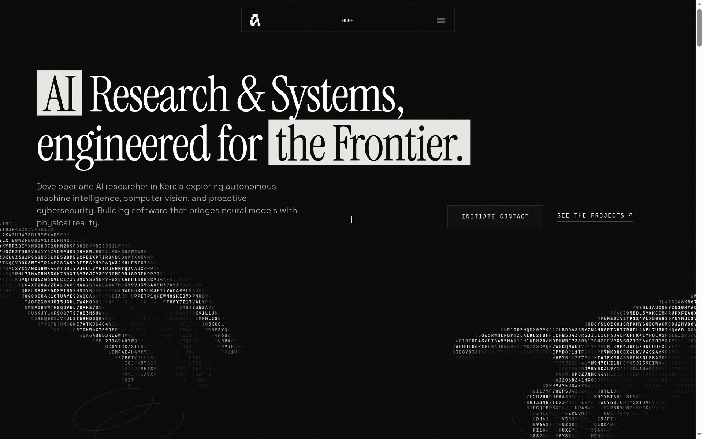

# Muhammed Arshad

> AI Research & Systems Architecture  
> Direct technical execution, from neural pipelines to bare-metal deployment.

[](https://arshadrafi.dev)

---

## Overview

Personal engineering portfolio and systems showcase designed with an editorial, high-density dark aesthetic inspired by Anthracite Studio. Built from scratch without heavy framework runtimes, prioritizing sub-2s load performance, zero layout shift (CLS 0.00), and fluid hardware-accelerated canvas motion.

**Live Deployment:** [arshadrafi.dev](https://arshadrafi.dev)

---

## Architectural Highlights

- **Dynamic ASCII Character Matrix:** Interactive canvas stage featuring mathematical glyph rasterization, real-time pointer repulsion physics, and dynamic vector emblem projection from the navigation bar.
- **Battery-Aware Render Lifecycle:** Canvas animation loops automatically suspend via `IntersectionObserver` when scrolled out of view or when the browser tab is backgrounded (`visibilitychange`), dropping idle CPU usage to 0%.
- **Scroll Physics & Scrubbing:** Pinned 220vh hero sequence with GSAP ScrollTrigger and Lenis smooth scrolling for precise spatial control and inertia.
- **Full Viewport Stability:** Dynamic viewport unit configuration (`100dvh` / `100svh`) prevents interface jump on mobile address bar collapse across iOS Safari and Chrome Android.
- **Accessible Semantics (A11y):** Full W3C semantic landmark hierarchy (`<nav>`, `<main id="main">`, `<footer>`) with explicit ARIA labeling, high-contrast monochrome tokens, and keyboard navigation support.

---

## Technology Stack

| Layer | Implementation |
| :--- | :--- |
| **Core Architecture** | Semantic HTML5, Custom CSS3 Variables, Vanilla ES6+ |
| **Animation & Motion** | GSAP 3, ScrollTrigger, Studio Freight Lenis |
| **Canvas & Graphics** | HTML5 Canvas 2D API, Custom ASCII shader algorithm |
| **Typography** | Space Grotesk, Inter, JetBrains Mono |
| **Design Tokens** | Minimalist dark palette (`#080807`), subtle hairline borders (`rgba(255,255,255,0.08)`) |

---

## Featured Works

1. **Gesture Gaming:** Spatial vision and hardware-accelerated gesture recognition pipelines.
2. **Mnemosyne:** Neural language model architecture and cognitive memory systems.
3. **Kage:** Low-level security tooling and proactive vulnerability auditing.
4. **NeuroMesh:** Decentralized multi-agent swarm consensus and dynamic execution graphs.

---

## Local Development

Serve the repository using any local HTTP static server:

```bash
# Python 3
python3 -m http.server 3000

# Node.js
npx serve .
```

Open `http://localhost:3000/` in any modern web browser.

---

## License

MIT License. Designed and engineered by Muhammed Arshad.
